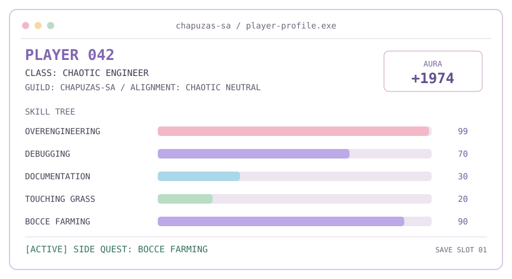

# `CHAPUZAS-SA`

**Professional overthinking. Amateur execution.**

`[ SYSTEM ONLINE ]` · `[ CHAOS ENABLED ]` · `[ AURA FARMING ]`

<picture>
  <source media="(prefers-color-scheme: dark)" srcset="./assets/character-stats-dark.svg">
  <source media="(prefers-color-scheme: light)" srcset="./assets/character-stats-light.svg">
  
</picture>

> It worked locally. — Ancient developer proverb

### `> TELEMETRY`

`404: Serious developer not found.`

**`[ SAVE GAME & EXIT ]`**

