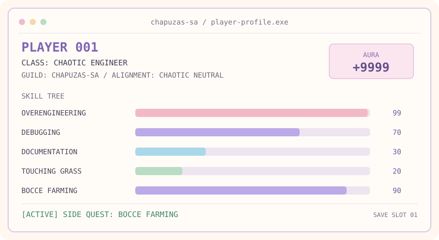

<div align="center">

# `CHAPUZAS-SA`

**Professional overthinking. Amateur execution.**

`[ SYSTEM ONLINE ]` · `[ CHAOS ENABLED ]` · `[ BOCCE FARMING ]`


</div>

---

<div align="center">
  
</div>

### `> ABOUT.EXE`

I turn coffee into code and simple problems into unnecessarily elaborate solutions.

Sometimes things work. Sometimes they become features.

> *"It worked locally." — Ancient developer proverb*

### `> TELEMETRY`

<div align="center">
  <a href="https://github.com/Chapuzas-SA">
    
  </a>
  <a href="https://github.com/Chapuzas-SA">
    
  </a>
</div>

### `> QUEST LOG`

```text
[x] Initialize repository
[x] Make questionable decisions
[x] Push to production
[ ] Read the documentation
[ ] Fix that one bug
[∞] Farm bocce aura
```

### `> SYSTEM STATUS`

```yaml
environment: production-ish
coffee: critical
bugs: evolving
technical_debt: legendary
current_mission: bocce farming
status: "probably fine"
```

---

<div align="center">

`404: Serious developer not found.`

*Built with questionable judgment and unreasonable confidence.*

**`[ SAVE GAME & EXIT ]`**

</div>
